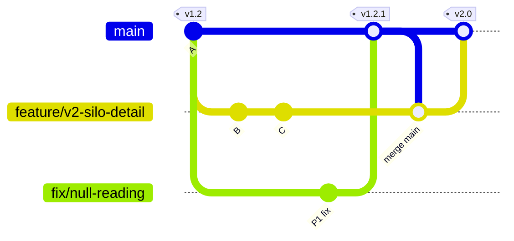

# GitHub Flow: cheat sheet

Reference reading for the branching part of the lab: the course's branching
strategy, applied to the release-week scenario you run in the You-do.

## The rules

- One long-lived branch: `main`.
- Every change starts as a short-lived branch off `main` (`feature/*`, `fix/*`) and
  returns to `main` through a pull request.
- A release is a merge to `main` plus a tag (`v1.2.1`). Production runs the last tag.

## The scenario

> Your team is dropping v2.0 of your Ignition project next week. Mid-week, an end
> user reports a P1 bug in v1.2, already running in production. You need to ship the
> v1.2 hotfix today AND keep v2.0 on track.

1. `main` is at `v1.2`, the tag production runs.
2. The v2.0 work is open on `feature/v2-silo-detail`, not merged yet.
3. The P1 hits. `fix/null-reading` branches off `main`, which is still v1.2, so the
   fix carries no v2.0 work.
4. The fix PR merges first, then `main` is tagged `v1.2.1`: production gets just the
   fix.
5. The feature branch merges `main` to pick up the fix.
6. The feature PR merges, then `main` is tagged `v2.0`.

## Merge order is release order

Whatever is on `main` when you tag ships in that release. Merge the feature before
the fix and the `v1.2.1` patch quietly ships half of v2.0.

## Where v1.2 lives

After step 6, `main` is v2.0. The old release lives in its tag: `git checkout v1.2`
gets you back to exactly what production ran.
